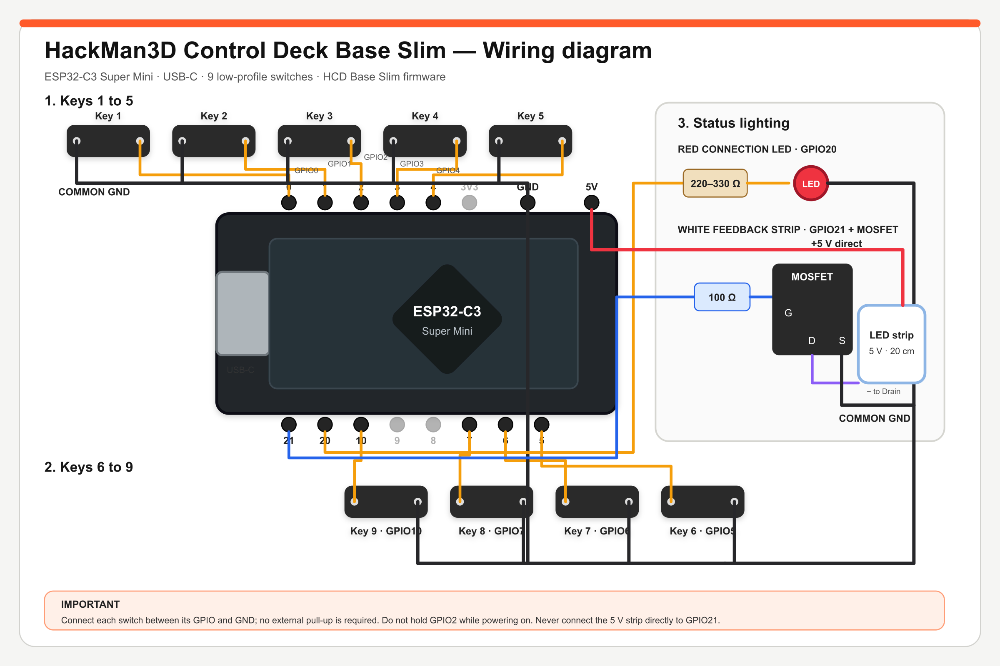

# HCD Base Slim wiring

The HCD Base Slim uses an ESP32-C3 Super Mini and nine normally-open
low-profile mechanical switches. The desktop application flashes the included
firmware directly; Arduino IDE is not required for normal installation.

## Pin mapping

| Function | ESP32-C3 connection |
| --- | --- |
| Key 1 | GPIO0 to GND |
| Key 2 | GPIO1 to GND |
| Key 3 | GPIO2 to GND |
| Key 4 | GPIO3 to GND |
| Key 5 | GPIO4 to GND |
| Key 6 | GPIO5 to GND |
| Key 7 | GPIO6 to GND |
| Key 8 | GPIO7 to GND |
| Key 9 | GPIO10 to GND |
| Red connection LED | GPIO20 → 200–330 Ω total resistance → LED anode; LED cathode → GND |
| White feedback strip control | GPIO21 → 100 Ω resistor → MOSFET Gate |

The switch inputs use `INPUT_PULLUP`, so no external pull-up resistors are
required. Either switch terminal may be used for the GPIO or GND connection.
All grounds must be connected together.

## Compact switch wiring and ESP32 installation

To reduce the amount of wiring inside the enclosure, connect one terminal of
each switch to its assigned GPIO and daisy-chain the other terminal from one
switch to the next to form a single common GND bus. Only one wire from this bus
then needs to return to an ESP32-C3 GND pin.

Female Dupont contacts are retained only at the ESP32 end of each wire, but the
standard plastic connector housings are too tall for this enclosure. Remove
each metal contact from its plastic housing and insulate it individually with
heat-shrink tubing. At the opposite end, cut off the connector, strip the wire
and solder it directly to the switch, LED or other component. Check that no
exposed conductor can touch a neighbouring pin or solder joint.

The ESP32-C3 header pins are soldered to the board and carefully bent to 90° so
the wiring exits parallel to the PCB. Support the pin while bending it and do
not apply force to the ESP32 solder pad. After assembly, verify continuity and
check for shorts between 5 V, 3.3 V and GND before connecting USB power.

## White 5 V feedback strip

Do not connect the 5 V LED strip directly to GPIO21. Use a logic-level
N-channel MOSFET suitable for a 3.3 V gate signal:

- strip `+` → ESP32-C3 `5V`;
- strip `−` → MOSFET `Drain`;
- MOSFET `Source` → common `GND`;
- GPIO21 → 100 Ω resistor → MOSFET `Gate`.

Confirm the exact Gate, Drain and Source order from the datasheet of the MOSFET
you use; the pin order is not identical on every package. The USB power source
must also be able to supply the strip current.

## Important

- Do not hold Key 3 / GPIO2 while powering on or resetting the ESP32-C3.
- Fit 200–330 Ω total resistance in series with the red LED. Two 100 Ω
  resistors soldered in series provide the validated 200 Ω option.
- Keep the 5 V strip off the GPIO pins and use the MOSFET stage shown above.
- Check for shorts between 5 V and GND before connecting USB.
